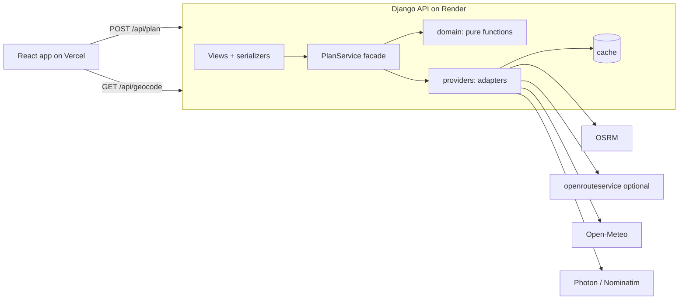

# Weather-Aware Truck Routing

A web app that recommends the safest truck route between two places, based on the weather along the route at the estimated arrival time, the load weight and the travel time.

- **App:** https://truck-routing-web.vercel.app
- **API:** https://truck-routing-api-dw0w.onrender.com (health: `/api/health`, readiness: `/api/ready`, schema: `/api/schema/`)

The API is on a free plan and sleeps when idle, so the first request after a quiet period takes up to a minute.

## Features

- Plan a trip from one place to another with a departure time, a load weight and a checkpoint spacing (10, 25 or 50 miles).
- Up to three distinct routes, each with checkpoints that show the estimated arrival time and the weather expected at that moment: wind, gusts, rain and snow.
- Every checkpoint has a risk level (Low, Moderate, High, Severe, No Travel, or Unknown) and the reasons for it, such as "Wind 47 mph with 42,000 lb load".
- A ranked recommendation that says why it won, or says that no route is safe.
- A weather heatmap along the corridor for the 48 hours after departure, with a slider and play button, and a truck marker that moves along the selected route. It can show risk, wind, rain or snow.
- Honest about gaps: where weather is missing the risk is Unknown, never Low, and the route is flagged as low confidence.
- Keyboard accessible, with a phone layout, and clear messages for slow starts and for each kind of error.

## Architecture



- **The server owns the rules.** Risk, load rules, scoring and ranking are pure Python in `backend/planner/domain`, with no Django and no network. The frontend only draws.
- **Providers are adapters** behind small interfaces (routing, weather, geocoding), so a service can be swapped or faked without touching the rules. Routing tries OSRM then openrouteservice; geocoding tries Photon then Nominatim.
- **Resilience is built in:** per-provider timeouts, one retry with jitter, a circuit breaker, a concurrency limit, a 20 s budget for a whole plan, and a cache that serves slightly old weather when the provider fails.
- **One request, one payload:** the plan response carries the routes, checkpoints and the whole 49-hour heatmap, so the slider never waits for the network.
- **Stateless:** there is no database. The cache is the only state and can be thrown away.

The full specification is in [`docs/SPEC.md`](docs/SPEC.md); the decisions behind the less obvious choices are in [`docs/adr/`](docs/adr/).

## How a plan is made

1. **Routes.** OSRM gives up to three alternatives. If it gives fewer, detours are routed through a point beside the midpoint of the trip. Duplicates and detours more than 40% longer are dropped, and the app says when fewer than three distinct routes exist.
2. **Travel time.** Each segment takes at least as long as driving it at 65 mph, so a truck is never faster than its limit.
3. **Checkpoints.** Points are placed every 10, 25 or 50 miles along each route, plus the destination, each with its estimated arrival time.
4. **Weather at arrival.** Open-Meteo hourly forecasts are fetched for the checkpoints (rounded to 0.1 degrees, in batches); any place Open-Meteo cannot supply is asked of the US National Weather Service. Rain and snow are totals for the hour before, so the hour after the arrival is used; wind is interpolated between the two hours around the arrival.
5. **Risk.** Wind, rain and snow are classified by the brief's bands, the load rules are applied, and the worst factor sets the checkpoint's level, with reasons. A stretch takes the worse of its two ends.
6. **Ranking.** Routes are ordered by No Travel miles, Severe miles, High miles, average risk, then duration. The reason names the first criterion that separates the best two.
7. **Heatmap.** A grid of at most 200 points near the routes is classified for each of the next 48 hours.

## Getting started

Needs [uv](https://docs.astral.sh/uv/) and Node 20 or later. In two terminals, from the repository root:

```bash
# 1. the API, on http://localhost:8000
cd backend && uv sync && DEBUG=true uv run python manage.py runserver

# 2. the web app, on http://localhost:5173 (it proxies /api to the API)
cd frontend && npm ci && npm run dev
```

Open http://localhost:5173, choose two places, and press Plan trip. To run without internet, start the API with `DEBUG=true PROVIDERS_MODE=fixtures`: it then answers from recorded responses, for a Boulder to Fort Collins trip only.

## API

The API is described by an OpenAPI schema at `/api/schema/` (checked in at `backend/openapi/schema.json`; the frontend types are generated from it).

| Method | Path              | Purpose                                                        |
| ------ | ----------------- | -------------------------------------------------------------- |
| GET    | `/api/health`     | Liveness, with no calls to other services                      |
| GET    | `/api/ready`      | Readiness: cache reachable, circuit breaker state per provider |
| GET    | `/api/geocode?q=` | Up to 8 places for a text of 3 to 100 characters               |
| POST   | `/api/plan`       | Routes, checkpoints, ranking and the heatmap for a trip        |

Errors share one shape, `{"error": {"code", "message", "field", "request_id"}}`, with the codes `VALIDATION`, `TOO_CLOSE`, `NO_ROUTE`, `RATE_LIMITED`, `UPSTREAM_ERROR`, `UPSTREAM_UNAVAILABLE` and `UPSTREAM_TIMEOUT`. Missing weather is not an error: the plan comes back with Unknown levels and a banner. Limits are 10 plans and 60 searches per minute per client.

## Configuration

The backend reads its settings from environment variables (`backend/.env` in development). Defaults are safe for development; production sets the ones marked **required**.

| Variable                                                      | Default                      | Meaning                                                                                          |
| ------------------------------------------------------------- | ---------------------------- | ------------------------------------------------------------------------------------------------ |
| `DEBUG`                                                       | `false`                      | Development mode. Never on in production.                                                        |
| `SECRET_KEY`                                                  | none                         | **Required** unless `DEBUG` is on.                                                               |
| `ALLOWED_HOSTS`                                               | `localhost,127.0.0.1`        | **Required** in production: the API's host name.                                                 |
| `CORS_ALLOWED_ORIGINS`                                        | none                         | **Required** in production: the exact web origin, e.g. `https://truck-routing-web.vercel.app`.   |
| `CSRF_TRUSTED_ORIGINS`                                        | none                         | The same origin.                                                                                 |
| `TRUST_PROXY_SSL_HEADER`                                      | `false`                      | `true` behind a proxy that sets `X-Forwarded-Proto` (Render).                                    |
| `TRUSTED_PROXY_COUNT`                                         | `0`                          | Proxies in front of the API that append to `X-Forwarded-For` (Render: `1`).                      |
| `SECURE_SSL_REDIRECT`, `SECURE_HSTS_SECONDS`                  | on / one year unless `DEBUG` | Transport security.                                                                              |
| `REDIS_URL`                                                   | empty                        | Shared cache and rate limits; without it each worker keeps its own in memory.                    |
| `ORS_API_KEY`                                                 | empty                        | Optional openrouteservice key, the routing fallback behind OSRM. A secret.                       |
| `PLAN_RATE_LIMIT`, `GEOCODE_RATE_LIMIT`, `RATE_LIMIT_ENABLED` | `10/m`, `60/m`, `true`       | Per-client limits.                                                                               |
| `TRUCK_MAX_SPEED_MPH`, `RISK_WIND_BASIS`                      | `65`, `sustained`            | Planning assumptions (SPEC section 4).                                                           |
| `UPSTREAM_USER_AGENT`, `UPSTREAM_ALLOWED_HOSTS`               | see settings                 | Identification and the allowlist for outbound requests.                                          |
| `PROVIDERS_MODE`, `ALLOW_FIXTURE_PROVIDERS`                   | `live`, `false`              | `fixtures` answers from recorded responses (tests, demos); refused in production unless allowed. |
| `LOG_LEVEL`                                                   | `INFO`                       | JSON logs on stdout.                                                                             |
| `PORT`, `WEB_CONCURRENCY`, `GUNICORN_THREADS`                 | `8000`, `2`, `4`             | Read by `config/gunicorn.conf.py`.                                                               |

The frontend reads two build-time variables: `VITE_API_BASE_URL` (the API's origin; empty means the same origin, which the development proxy uses) and `VITE_MAP_STYLE_URL` (a different basemap style).

## Development

Prerequisites: git, [uv](https://docs.astral.sh/uv/), Node 20+, make and [pre-commit](https://pre-commit.com/).

```bash
make check             # everything CI runs (backend and frontend)
make be-test ARGS="-k health"   # focused backend tests
pre-commit install     # run the hooks on every commit
pre-commit run --all-files
```

The hooks run ruff, mypy, prettier, eslint and gitleaks, plus basic file hygiene checks. ruff, mypy, prettier and eslint come from the project lockfiles, so hook results match CI.

The backend reads its settings from the environment; for local development copy `backend/.env.example` to `backend/.env`.

## Testing

```bash
make check                          # everything CI runs
make be-test ARGS="-k risk"         # a focused backend run
make fe-e2e                         # the browser test (first: cd frontend && npx playwright install chromium)
```

- **Backend:** pytest with a coverage gate in CI (the whole backend at least 85%; the pure domain is at 100% and the backend overall at 99%). Boundary values of every band are tested on both sides, with property tests for ordering; providers are tested against recorded responses and never touch the network.
- **Frontend:** Vitest and Testing Library for components, hooks and map code (MapLibre is replaced by a fake), and axe-core for accessibility.
- **End to end:** one Playwright test plans a trip against the real API running on recorded responses, opens a checkpoint on the map and moves the forecast.

## Security scanning

Every pull request runs ruff (including its security rules), bandit, pip-audit, `npm audit` (high and above), gitleaks and CodeQL for Python and TypeScript, and Dependabot proposes updates. Inputs are validated at the API boundary, outbound requests go only to an allowlist of hosts, logs never hold full-precision coordinates, and the deployed headers (CSP and others) are set in `frontend/vercel.json` and the Django settings.

## Deployment

The API runs on [Render](https://render.com) (free web service) and the web app on [Vercel](https://vercel.com). Both are configured in the repository: `render.yaml` and `frontend/vercel.json`.

1. **API.** In Render choose New, Blueprint and pick this repository. Render creates `truck-routing-api` from `render.yaml`, generates `SECRET_KEY` and asks for the values marked `sync: false`. Leave `CORS_ALLOWED_ORIGINS` and `CSRF_TRUSTED_ORIGINS` for step 3; add `ORS_API_KEY` if you have one. If your service gets a different host name than `truck-routing-api-dw0w.onrender.com`, set `ALLOWED_HOSTS` to it.
2. **Web app.** In Vercel import the repository and set the root directory to `frontend`. Add `VITE_API_BASE_URL` = the API's origin (`https://truck-routing-api-dw0w.onrender.com`) and deploy. The Content Security Policy in `frontend/vercel.json` names the API origin; change it there if the host name differs.
3. **Connect them.** Set `CORS_ALLOWED_ORIGINS` and `CSRF_TRUSTED_ORIGINS` on the API to the exact Vercel origin (no trailing slash) and let it redeploy.
4. **Check.** `GET <api>/api/ready` returns 200, and a trip planned on the web app draws routes and the forecast.

Things worth knowing, learned from the first deploy:

- Vercel must build from `frontend`. Setting the root directory when importing the project is not enough if the GitHub integration builds first; check Project Settings, General, Root Directory.
- Render appends a random suffix to the service's host name. Read the real name from the dashboard before setting `ALLOWED_HOSTS` and the CSP.
- The free Open-Meteo API limits each outbound address to 10,000 calls a day, and a free Render instance shares its address with other apps. When the limit is hit the API answers 200 with a banner "Weather is unavailable" and every route shown as Unknown (never as Low), and the log says `weather batch lost ... Daily API request limit exceeded`. The limit resets at midnight UTC; for steady use, get an Open-Meteo plan or move the API to a host with its own address.

The free API service sleeps after a quiet period; the app pings `/api/health` on load and says so while the server wakes up (about a minute).

## Assumptions and known limits

Assumptions (the choices behind the numbers; see the [decision records](docs/adr/) for the reasoning):

1. Risk bands are half-open, lower bound inclusive. Rain of exactly 1.00 in/hr and snow of exactly 3.0 in/hr are Severe.
2. Load thresholds are strict: more than 30,000 lb and more than 40,000 lb.
3. No Travel miles rank before Severe miles.
4. The risk of a stretch is the worse of its two checkpoints.
5. Wind is classified on the sustained 10 m wind by default; gusts are shown, and the basis is configurable.
6. The rain rate is rain plus showers.
7. Slider hour 0 is the departure time rounded down to the hour.
8. Truck speed is capped at 65 mph and there are no rest breaks.
9. The routing provider may be car-only, so truck restrictions are not guaranteed.

Known limits:

- Arrival times assume continuous driving. Hours-of-service rest stops are not modelled.
- Routes come from a car profile, so low bridges, weight limits and truck bans are not considered.
- Weather is a forecast on a 0.1 degree grid; departures up to 7 days ahead are accepted, but the heatmap covers 48 hours.
- The free services have limits of their own: the OSRM demo server is best effort, and Open-Meteo is free for non-commercial use.
- The free API host sleeps when idle, so the first request after a quiet period can take up to a minute; the app says so.
- There are no accounts and no saved trips.
- Without `REDIS_URL` each worker keeps its own cache and rate counters.

Scaling path: add Redis (`REDIS_URL`) so workers share the cache and limits, then more workers or instances, which is safe because the API is stateless. For heavier use, move routing to a self-hosted or paid router, use a commercial weather plan, and raise the rate limits.

## Data sources and attribution

- Map data © [OpenStreetMap](https://www.openstreetmap.org/copyright) contributors, basemap by [OpenFreeMap](https://openfreemap.org).
- Routing by [OSRM](https://project-osrm.org) (and optionally [openrouteservice](https://openrouteservice.org)).
- Weather data by [Open-Meteo.com](https://open-meteo.com), licensed CC BY 4.0, with the [US National Weather Service](https://www.weather.gov/) as a fallback.
- Place search by [Photon](https://photon.komoot.io) and [Nominatim](https://nominatim.org).

## License

[MIT](LICENSE)
