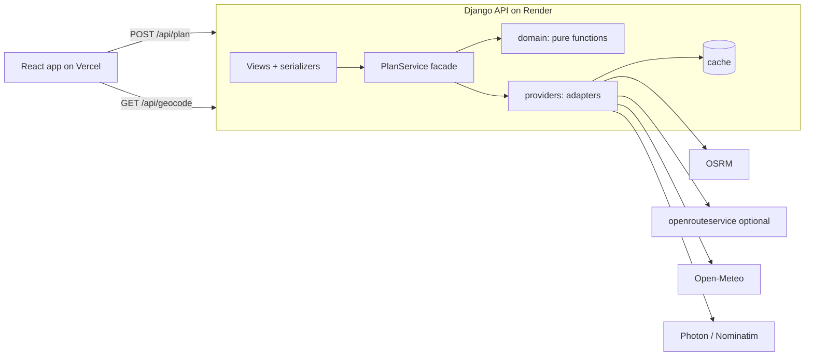

# Weather-Aware Truck Routing — Technical Specification

Status: v1.0 · Source of truth for implementation. If code and this spec disagree, fix the code or update this spec in the same PR.

## 1. Goal and scope

A React + Django web app that helps a truck driver choose the safest route between two places, based on weather along the route at the truck's estimated arrival time, the load weight, and travel time.

**In scope**

- User enters origin, destination, departure date/time, load weight (lb), checkpoint interval (10 / 25 / 50 mi).
- App returns up to 3 distinct routes, checkpoints with ETA and weather risk, a ranked recommendation with a reason, and a corridor weather heatmap for 0–48 h after departure.
- Everything shown on a map.

**Out of scope (documented as known limits)**

- Hours-of-service rest stops (ETAs assume continuous driving).
- Truck-specific road restrictions when the routing provider is car-only.
- User accounts, persistence, history.

**Evaluation priorities** (from the brief): logic correctness 40%, UI/map/heatmap smoothness 40%, code quality 15%, docs 5%. Correctness and clarity beat extra features.

## 2. Stack

| Layer            | Choice                                                                                                                                                                                                                             |
| ---------------- | ---------------------------------------------------------------------------------------------------------------------------------------------------------------------------------------------------------------------------------- |
| Backend          | Python 3.12, Django 6.x, Django REST Framework, drf-spectacular (OpenAPI), httpx, gunicorn (gthread)                                                                                                                               |
| Backend tooling  | uv (deps + lockfile), ruff (lint + format, incl. `S` security rules), mypy (strict on `planner/domain` and `planner/providers`), pytest, pytest-django, pytest-cov, respx, hypothesis (boundary/property tests), bandit, pip-audit |
| Frontend         | React 19 + TypeScript (strict) + Vite, MapLibre GL JS, TanStack Query, openapi-typescript (types generated from the backend schema)                                                                                                |
| Frontend tooling | eslint (typescript-eslint strict-type-checked, react-hooks, jsx-a11y), prettier, vitest + Testing Library, Playwright (one smoke test)                                                                                             |
| Repo tooling     | pre-commit, gitleaks, GitHub Actions, CodeQL, Dependabot                                                                                                                                                                           |
| Hosting          | Backend on Render (free web service), frontend on Vercel                                                                                                                                                                           |

External services (all keyless unless noted):

| Purpose                     | Service                                                         | Constraints                                                                               |
| --------------------------- | --------------------------------------------------------------- | ----------------------------------------------------------------------------------------- |
| Routing                     | OSRM public demo server (`router.project-osrm.org`)             | ≤ 1 req/s, best effort, car profile, valid User-Agent, attribution (ODbL + OSRM)          |
| Routing fallback (optional) | openrouteservice `driving-hgv` (free API key via `ORS_API_KEY`) | Alternatives only ≤ 100 km, so used for single routes + via-point detours                 |
| Geocoding                   | Photon (komoot) primary, Nominatim fallback                     | Nominatim: ≤ 1 req/s, no autocomplete use                                                 |
| Weather                     | Open-Meteo forecast API                                         | Free tier 600/min, 5,000/h, 10,000/day, non-commercial, CC BY 4.0 attribution             |
| Weather fallback            | US National Weather Service (`api.weather.gov`)                 | Keyless, United States only, User-Agent required; grid forecast data, two calls per place |
| Basemap                     | OpenFreeMap vector tiles                                        | Attribution                                                                               |

## 3. Architecture



Principles:

1. **Server owns the rules.** All risk, load, scoring and ranking logic is pure Python in `planner/domain`, with no Django or I/O imports. The frontend renders only.
2. **One request, one payload.** `/api/plan` returns routes, checkpoints, scores, recommendation and the full 49-hour heatmap so the slider never touches the network.
3. **Explainability.** Every checkpoint carries human-readable reasons; the recommendation carries the deciding criterion.
4. **Degrade, never lie.** If weather is unavailable the risk is `UNKNOWN`, never `LOW`.
5. **Stateless API.** No database; cache is the only state and is disposable. Horizontal scaling needs only a shared cache (Redis via env).

### 3.1 Design patterns (apply where they earn their place, nowhere else)

| Pattern                                           | Where                                                                          | Why                                                      |
| ------------------------------------------------- | ------------------------------------------------------------------------------ | -------------------------------------------------------- |
| Value objects (frozen dataclasses)                | `domain/models.py`: `LatLon`, `Checkpoint`, `RouteScore`, `WeatherSample`      | Immutability, easy equality in tests                     |
| Ports and adapters (Protocol + adapter)           | `providers/` implement `RoutingProvider`, `WeatherProvider`, `GeocodeProvider` | Swap services without touching domain; fixtures in tests |
| Chain of responsibility                           | `FallbackRoutingProvider([osrm, ors])`                                         | Provider failover                                        |
| Facade                                            | `services/plan.py::PlanService`                                                | One entry point orchestrating providers + domain         |
| Circuit breaker                                   | `infra/http.py` per provider                                                   | Fail fast when a provider is down                        |
| Cache-aside with stale-if-error                   | `infra/cache.py`                                                               | Serve slightly old data during outages                   |
| Dependency injection (constructor)                | `services/container.py` builds the object graph from settings                  | Testability, no globals                                  |
| Table-driven rules                                | `domain/risk.py` band tables as data                                           | The brief's table maps 1:1 to code                       |
| Frontend: container/presentational + custom hooks | `usePlan`, `useHeatmapFrames`, `useMapLayer`                                   | Keep map imperative code out of components               |

Do not add: repositories over a DB we don't have, event buses, CQRS, microservices.

## 4. Core pipeline (`PlanService.plan`)

### 4.1 Routes

1. Request OSRM `route/v1/driving/{o};{d}?alternatives=3&overview=full&geometries=geojson&annotations=distance,duration&steps=false`.
2. If fewer than 3 routes: generate via-point detours. Midpoint `m` of the fastest route; offset perpendicular to the origin→destination bearing by `±max(15 km, 0.08 × straight-line distance)`; route `o → via → d`.
3. Deduplicate: sample each route every 1 km; a candidate is a duplicate if > 85% of its samples lie within 1 km of an already-kept route.
4. Reject detours whose distance exceeds the fastest route by > 40%.
5. Keep at most 3, ordered by duration. If fewer than 3 remain, add note `"Only N distinct routes exist for this trip"`. Never pad with duplicates.
6. OSRM calls are serialized with ≥ 1.1 s spacing (process-wide lock). Route results cached by `(rounded origin, rounded destination, provider)` for 1 h.

Errors: origin/destination < 1 mi apart → 400 `TOO_CLOSE`. `NoRoute` → 422 `NO_ROUTE`. Snap distance (`waypoints[].distance`) > 5 km → warning note.

### 4.2 Truck travel time

Per OSRM segment: `duration_truck = max(osrm_duration, distance_m / TRUCK_MAX_SPEED_MPS)` where `TRUCK_MAX_SPEED_MPH = 65` (setting). Note in response: `"ETAs assume continuous driving at ≤ 65 mph"`.

### 4.3 Checkpoints

Interval `d ∈ {10, 25, 50}` miles. Using cumulative haversine distance and cumulative truck time along the polyline:

- Positions at `0, d, 2d, …` plus always the destination; interpolate linearly within a segment.
- `eta = departure + interpolated cumulative time`.
- Each checkpoint `i` (except last) owns the stretch to `i+1`; its length is the real distance (last stretch usually < d).

### 4.4 Weather at ETA

- Variables: `wind_speed_10m, wind_gusts_10m, rain, showers, snowfall, weather_code`; params `wind_speed_unit=mph&precipitation_unit=inch&timeformat=unixtime&timezone=GMT`.
- Assert `hourly_units` equal `mp/h` (how Open-Meteo spells miles per hour, requested with `wind_speed_unit=mph`) / `inch`, and `time` equal `unixtime`; a mismatch raises `UpstreamContractError` (never silently convert).
- Coordinates rounded to 0.1° for cache keys and deduplication; batches of ≤ 100 coordinates; ≤ 4 concurrent batches.
- Cache per rounded point: hourly series, TTL 30 min, stale-if-error up to 6 h (response flagged `weather_stale: true`).
- Hour selection: precipitation values are sums over the **preceding** hour → for ETA `t` use the value at `ceil_hour(t)`. Wind is instantaneous → linear interpolation between `floor_hour(t)` and `ceil_hour(t)`.
- `rain_rate = rain + showers`; `snow_rate = snowfall`.
- ETA outside returned series or value `null` → that factor `UNKNOWN`.
- Fallback source: places Open-Meteo cannot supply (for example when its daily limit is exhausted) are asked of the NWS in the order given, checkpoints first, then the heatmap grid, within the same request budget. The NWS grid forecast is converted to the same units and the same convention (a precipitation value at hour `h` covers the hour before `h`): km/h → mph; precipitation and snowfall totals in mm are spread evenly over their interval and converted to in/hr; rain is the precipitation total minus the snow's meltwater (snowfall ÷ 10). Places the NWS does not cover stay `UNKNOWN`. `meta.weather_source` is `open-meteo`, `nws`, or `open-meteo+nws`.

### 4.5 Risk classification

Levels (ordered int enum): `LOW=0, MODERATE=1, HIGH=2, SEVERE=3, NO_TRAVEL=4`, plus `UNKNOWN` (not ordered, excluded from averages).

Bands are half-open, lower bound inclusive; the top edge of Severe is inclusive where the brief says "> x" for No Travel:

| Factor                | LOW    | MODERATE     | HIGH         | SEVERE       | NO_TRAVEL |
| --------------------- | ------ | ------------ | ------------ | ------------ | --------- |
| Wind (mph, sustained) | < 25   | [25, 35)     | [35, 45)     | [45, 55)     | ≥ 55      |
| Rain (in/hr)          | < 0.10 | [0.10, 0.25) | [0.25, 0.50) | [0.50, 1.00] | > 1.00    |
| Snow (in/hr)          | < 0.5  | [0.5, 1.0)   | [1.0, 2.0)   | [2.0, 3.0]   | > 3.0     |

Load rules applied after the weather table, in order:

1. wind ≥ 55 → NO_TRAVEL (any load)
2. 45 ≤ wind < 55 and load > 30,000 lb → NO_TRAVEL
3. 35 ≤ wind < 45 and load > 40,000 lb → SEVERE

Checkpoint level = max over factors (after load rules). If any factor is UNKNOWN and the known max is below SEVERE, level is UNKNOWN; if a known factor is already ≥ SEVERE, keep it (an outage can't hide known danger).

Reasons: one string per factor at MODERATE or above, plus one per triggered load rule, e.g. `"Wind 47 mph with 42,000 lb load → No Travel"`.

Wind basis is configurable: `RISK_WIND_BASIS=sustained|gust` (default `sustained`, matching the brief's table). Gusts are always returned for display.

### 4.6 Route scoring

- Stretch level = worse (max) of its two endpoint checkpoints; UNKNOWN if either is UNKNOWN and the other is < SEVERE.
- `miles_by_level`, `unknown_miles`, `avg_risk` = distance-weighted mean of known stretch levels (0–4), `worst_level`, `duration_s`, `distance_mi`.
- `low_confidence = unknown_miles / distance_mi > 0.20`.

### 4.7 Recommendation

Sort key (ascending):

```python
(round(no_travel_miles, 1), round(severe_miles, 1), round(high_miles, 1), round(avg_risk, 2), duration_s)
```

No Travel miles rank first (documented assumption: the brief lists Severe first but a No-Travel route must never outrank a Severe one). Rounding prevents float noise from deciding.

- `recommendation_reason` = first criterion that separates #1 from #2, phrased for humans.
- If every route has `no_travel_miles > 0` → `recommended_route_id = null`, banner `NO_SAFE_ROUTE`; routes still ranked.
- Unknown miles never count as Low.

### 4.8 Corridor heatmap

- Bounding box of all route geometries buffered 25 km; grid spacing chosen so the masked grid has ≤ 200 points (start 0.1°, double until it fits).
- Keep points within 25 km of any route (corridor mask).
- 49 hourly frames starting at `floor_hour(departure)`; each frame has per-point `risk` (level int, -1 = unknown), `wind`, `rain`, `snow`.
- Shares the weather cache with checkpoints.

## 5. API

OpenAPI schema at `/api/schema/`; frontend types generated from it.

| Method | Path              | Notes                                                  |
| ------ | ----------------- | ------------------------------------------------------ |
| GET    | `/api/health`     | Liveness, no upstream calls                            |
| GET    | `/api/ready`      | Readiness: breaker state per provider, cache reachable |
| GET    | `/api/geocode?q=` | ≥ 3 chars, ≤ 100 chars, cached 24 h, max 8 results     |
| POST   | `/api/plan`       | See below                                              |
| GET    | `/api/demo`       | The recorded storm demo (section 5.1)                  |

Request:

```json
{
  "origin": { "lat": 41.8781, "lon": -87.6298, "label": "Chicago, IL" },
  "destination": { "lat": 39.7392, "lon": -104.9903, "label": "Denver, CO" },
  "departure_at": "2026-10-18T06:00:00-05:00",
  "load_lb": 42000,
  "interval_mi": 25
}
```

Validation: lat ∈ [-90, 90], lon ∈ [-180, 180]; `departure_at` must include an offset and lie in [now − 15 min, now + 7 days] (past-but-within-15-min is clamped to now); `load_lb` integer 0–200,000 (warning note above 80,000); `interval_mi ∈ {10, 25, 50}`; labels ≤ 200 chars; origin/destination ≥ 1 mi apart.

Response shape (abridged):

```json
{
  "recommended_route_id": "r1",
  "recommendation_reason": "0 Severe miles vs 18 on Route B",
  "banner": null,
  "routes": [
    {
      "id": "r1",
      "label": "Route A",
      "rank": 1,
      "distance_mi": 1003.4,
      "duration_s": 58200,
      "geometry": { "type": "LineString", "coordinates": [[-87.63, 41.88]] },
      "summary": {
        "miles_by_level": {
          "LOW": 812.0,
          "MODERATE": 160.4,
          "HIGH": 31.0,
          "SEVERE": 0,
          "NO_TRAVEL": 0
        },
        "unknown_miles": 0,
        "avg_risk": 0.22,
        "worst_level": "HIGH",
        "low_confidence": false
      },
      "checkpoints": [
        {
          "index": 1,
          "mile": 25.0,
          "lat": 41.6,
          "lon": -88.1,
          "eta": "2026-10-18T11:31:00Z",
          "wind_mph": 18.2,
          "gust_mph": 29.0,
          "rain_in_hr": 0.02,
          "snow_in_hr": 0,
          "level": "LOW",
          "reasons": []
        }
      ]
    }
  ],
  "heatmap": {
    "start": "2026-10-18T11:00:00Z",
    "points": [[41.9, -87.7]],
    "frames": [{ "risk": [0], "wind": [18.2], "rain": [0.02], "snow": [0] }]
  },
  "notes": ["ETAs assume continuous driving at ≤ 65 mph"],
  "meta": {
    "routing_source": "osrm",
    "weather_source": "open-meteo",
    "weather_stale": false,
    "generated_at": "…",
    "request_id": "…"
  }
}
```

Errors (single shape): `{"error": {"code": "NO_ROUTE", "message": "…", "field": null, "request_id": "…"}}`.

| Status | Codes                                                          |
| ------ | -------------------------------------------------------------- |
| 400    | `VALIDATION`, `TOO_CLOSE`                                      |
| 422    | `NO_ROUTE`                                                     |
| 429    | `RATE_LIMITED` (our limit: 10 plans/min/IP, 60 geocode/min/IP) |
| 502    | `UPSTREAM_ERROR`                                               |
| 503    | `UPSTREAM_UNAVAILABLE` (breaker open)                          |
| 504    | `UPSTREAM_TIMEOUT`                                             |

Partial weather failure is **not** an error: 200 with UNKNOWN levels and banner `WEATHER_UNAVAILABLE`. The banner is for a checkpoint without weather; heatmap cells off the routes without weather only add a note and are drawn grey.

### 5.1 Stormy demo

`GET /api/demo?load_lb=&interval_mi=` (defaults 42,000 and 25) returns the same response as `/api/plan` for a fixed trip, Denver to Salt Lake City by three recorded roads, in a recording of the wind storm of 17 January 2024 on I-80 in Wyoming. It runs the real `PlanService` with a routing provider and a weather provider that replay `backend/fixtures/demo`, moved in time so the storm starts at the request. `meta.routing_source` and `meta.weather_source` are `demo`, and the web app shows a banner that this is a recording. It uses no upstream service. See [ADR 5](adr/0005-recorded-storm-demo.md).

## 6. Resilience

| Concern         | Rule                                                                                                                                                    |
| --------------- | ------------------------------------------------------------------------------------------------------------------------------------------------------- |
| Timeouts        | routing 8 s, weather 10 s, geocode 4 s (connect 3 s)                                                                                                    |
| Deadline budget | whole plan request 20 s; each call gets `min(own timeout, remaining budget)`                                                                            |
| Retries         | 1 retry on 5xx / 429 / connect errors, exponential backoff with full jitter (base 300 ms); never on 4xx                                                 |
| Circuit breaker | per provider: open after 3 consecutive failures, half-open after 60 s                                                                                   |
| Bulkheads       | separate concurrency limit per provider (OSRM 1, Open-Meteo 4, NWS 16, geocode 2)                                                                       |
| Fallbacks       | routing OSRM → ORS (if key); weather Open-Meteo → NWS (only for places Open-Meteo could not supply) → stale cache → UNKNOWN; geocode Photon → Nominatim |
| Rate limiting   | per-IP limits (django-ratelimit) backed by the cache                                                                                                    |
| Cache           | Django cache framework; LocMem by default, Redis via `REDIS_URL`                                                                                        |

## 7. Frontend

- Form defaults: origin Chicago, destination Denver (the example trip of section 5), departure at the next full hour, 42,000 lb, 25 mi checkpoints, so a first visit can plan at once. Editing a place field un-chooses it until a new one is picked.
- Layout: full-screen map; left panel (form + route cards); bottom forecast slider. Mobile: panel becomes bottom sheet.
- Map: MapLibre, created once. Layers: routes (recommended thick, on top), checkpoints (one GeoJSON source, data-driven color), heatmap, truck marker at slider hour on the selected route.
- Heatmap: MapLibre `heatmap` layer, weight = level/4, ramp green → yellow → orange → red → purple, unknown = grey; fades to circles above zoom 9. 49 FeatureCollections built once with `useMemo`; slider calls `setData`, throttled with `requestAnimationFrame`. Play button steps 1 h / 400 ms. Toggle: risk / wind / rain / snow. Label shows absolute local time and offset.
- Route cards: rank badge, duration, distance, stacked bar of miles by level, reason on the winner; hover highlights route; click selects.
- Checkpoint popup: ETA (local, with tz), wind, gust, rain, snow, level, reasons.
- Demo: a "Try the stormy demo" button sets the form to the recorded trip (keeping the load and the spacing) and calls `/api/demo`; a plan whose weather source is `demo` carries a banner that it is a recording, not a live forecast. Try again repeats the demo.
- States: cold start ("Waking up the server…", triggered by `/api/health` ping on load), loading steps, error per code, empty, stale inputs ("Inputs changed — re-plan").
- Accessibility: never color alone; keyboard slider; focus management; WCAG AA contrast.
- Attribution visible: © OpenStreetMap contributors, OSRM, Open-Meteo (CC BY 4.0), OpenFreeMap.
- Performance budget: slider ≥ 55 fps on a mid-range laptop; initial JS ≤ 300 KB gzipped (MapLibre lazy-loaded chunk excluded); plan response ≤ 300 KB gzipped.

## 8. Security

- Secrets only from env; `.env` never committed; gitleaks in pre-commit and CI.
- `DEBUG=False` in production; `manage.py check --deploy` passes in CI.
- `ALLOWED_HOSTS`, `CORS_ALLOWED_ORIGINS` (exact Vercel origin), `CSRF_TRUSTED_ORIGINS`, `SECURE_PROXY_SSL_HEADER`, HSTS, `SECURE_CONTENT_TYPE_NOSNIFF`, `X_FRAME_OPTIONS=DENY`.
- Frontend security headers in `vercel.json` (CSP allowing only self, the API origin, tile and font hosts; `Referrer-Policy`, `Permissions-Policy`).
- Input validation on every field; geocode query length-capped; no user input interpolated into URLs without encoding (httpx params).
- Outbound requests only to an allowlist of hosts defined in settings (prevents SSRF if code ever takes URLs).
- Dependency scanning: pip-audit, npm audit (high+), Dependabot weekly; SAST: ruff `S` rules, bandit, CodeQL.
- No PII stored; logs never include full coordinates beyond 2 decimals.

## 9. Observability

- Structured JSON logs; `X-Request-ID` accepted or generated, echoed in response and error body.
- Per plan: distance, route count, checkpoint count, unique weather points, cache hit ratio, upstream latencies, breaker states, total duration.

## 10. Repository layout

```
backend/
  config/            settings (env-driven), urls, wsgi, gunicorn.conf.py
  planner/
    domain/          pure: models, risk, geometry, sampling, weather_select, scoring, ranking, corridor, routes_select
    infra/           http (timeouts, retry, breaker, deadline), cache, metrics (per-request counters), jsonlog (JSON log formatter)
    providers/       routing_osrm, routing_ors, weather_openmeteo, weather_nws, geocode_photon, geocode_nominatim, recorded (demo replay), protocols
    services/        plan (facade), demo, container (DI)
    api/             serializers, views, errors, urls
  tests/             unit/, providers/ (respx fixtures), api/
  fixtures/          recorded upstream JSON; demo/ is the recorded storm corridor
  scripts/           record_demo.py
frontend/
  src/ api/ components/ map/ hooks/ lib/ types/
  e2e/
.github/ workflows/ ISSUE_TEMPLATE/ PULL_REQUEST_TEMPLATE.md dependabot.yml
docs/ SPEC.md BACKLOG.md adr/
Makefile README.md render.yaml .pre-commit-config.yaml
```

## 11. Definition of done (every issue)

- Acceptance criteria met; tests added/updated (domain coverage ≥ 95%, overall backend ≥ 85%).
- `make check` green locally: lint, format check, types, tests, security scans, frontend typecheck/lint/tests/build.
- CI green on the PR.
- No TODOs without a linked issue; no commented-out code; no debug prints.
- Docs (README / SPEC / ADR) updated if behavior or decisions changed.

## 12. Assumptions register (keep in README)

1. Risk bands are half-open, lower bound inclusive; Rain 1.00 and Snow 3.0 exactly are Severe.
2. Load thresholds are strictly greater (> 30,000 / > 40,000 lb).
3. No Travel miles rank before Severe miles.
4. Stretch risk = worse of its two checkpoints.
5. Wind classified on sustained 10 m wind by default; gusts shown and configurable.
6. Rain rate = rain + showers.
7. Slider hour 0 = departure time (rounded down to the hour).
8. Truck speed capped at 65 mph; no rest breaks.
9. Routing provider may be car-profile; truck restrictions not guaranteed.
10. NWS fallback weather: snow melts to a tenth of its depth, and interval totals are spread evenly over their hours (peaks within a 6-hour interval are smoothed).
